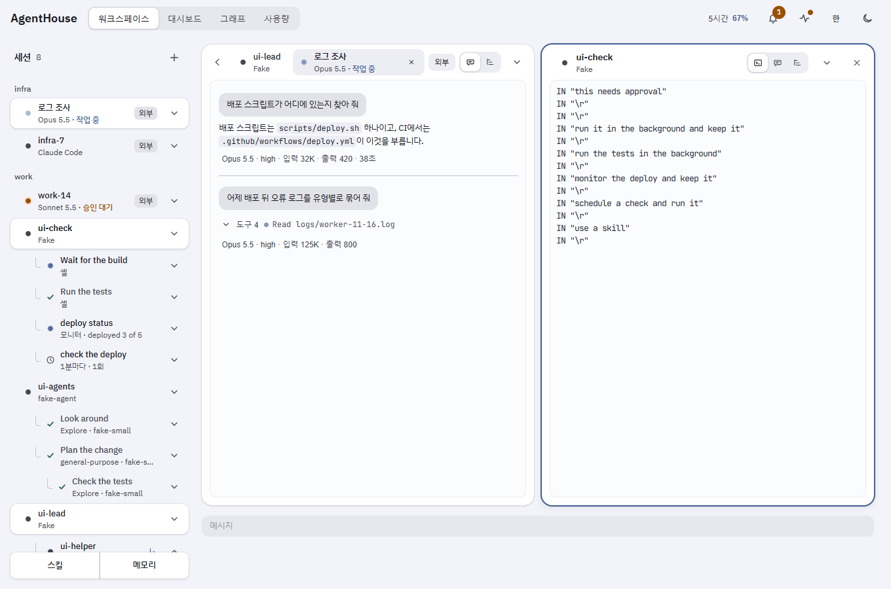
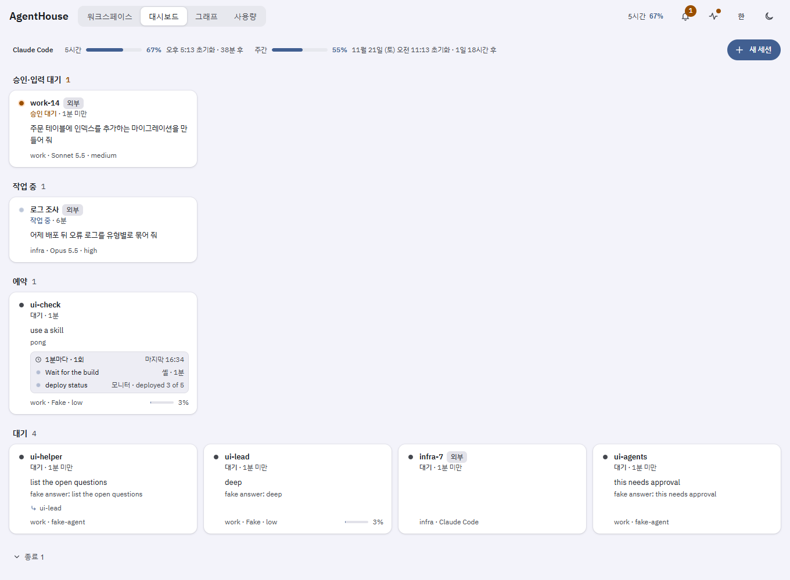
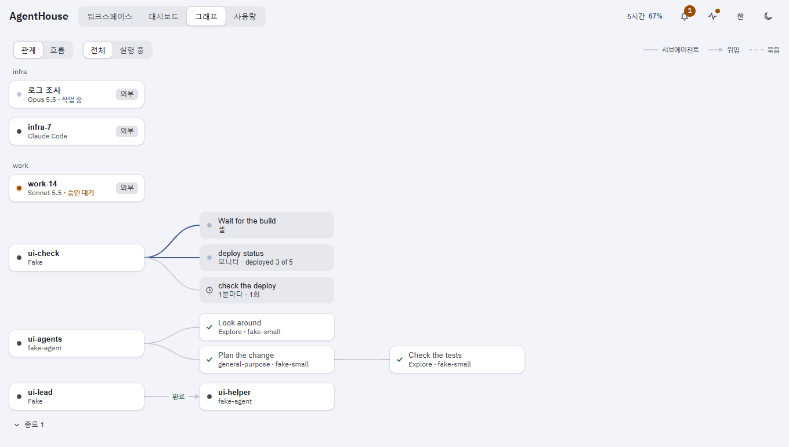
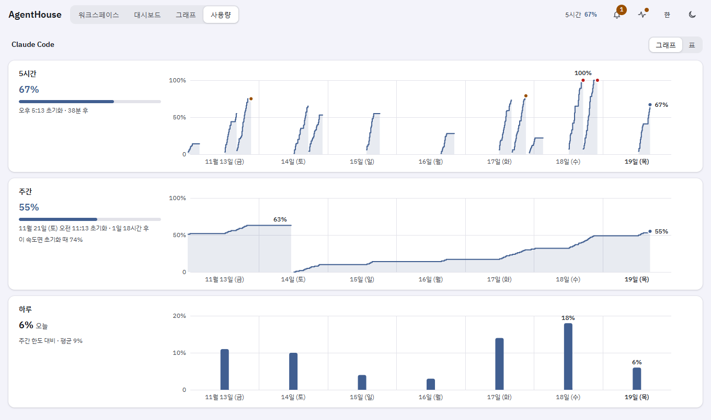

# AgentHouse

[English](README.md) · 한국어

Claude Code 세션 여러 개를 브라우저의 실제 터미널에서 나란히 실행하고, 세션마다 지금 무엇을 하는지 한눈에 보여 주는 로컬 웹 콘솔입니다.



## 기능

### 워크스페이스

- **브라우저 안의 실제 터미널**: 설치된 Claude Code를 그대로, 내 계정으로 실행합니다. Windows Terminal처럼 `Ctrl+C`는 선택한 글을 복사하고 `Ctrl+V`는 붙여 넣습니다.
- **탭과 자유 분할**: 한 칸에 세션 여러 개를 탭으로 두고, 화면을 좌우·위아래로 여섯 칸까지 나눕니다. 세션을 끌어 놓아 배치하고, 칸 사이를 끌어 크기를 바꿉니다.
- **세션 트리**: 세션마다 작업 중·승인 대기·대기가 보이고, 그 아래에 그 세션이 띄운 서브에이전트, 백그라운드 명령, 예약한 프롬프트(`/loop`)가 달립니다.
- **대화 보기**: 터미널 대신 프롬프트, 응답, 도구 호출, 서브에이전트를 턴별 모델·effort·토큰과 함께 읽습니다.
- **흐름 보기**: 세션과 그 서브에이전트가 언제 일했는지를 시간 막대로 봅니다.
- **입력창**: 한글 입력이 깨지지 않고, 세션을 끌어 놓으면 여러 세션에 한 번에 보냅니다(`Ctrl+Enter`). 승인이나 답을 기다리는 세션에는 보내지 않으므로 메시지가 대화상자에 답하는 일이 없습니다.
- **묶기와 위임**: 세션을 다른 세션 아래에 묶거나, 한 세션의 답을 다른 세션에 일로 맡기고 결과를 돌려받습니다.
- **끊기지 않는 세션**: 서버를 껐다 켜도 세션은 계속 돌고, 끝난 세션은 대화가 멈춘 곳부터 이어서 엽니다.

### 대시보드



모든 세션을 카드 한 장씩, 하는 일에 따라 보여 줍니다: 승인·입력 대기, 작업 중, 예약, 대기, 종료. 카드에는 그 상태로 지낸 시간, 마지막 프롬프트와 답, 그 세션에서 지금 도는 것, 폴더·모델·effort·컨텍스트가 나옵니다.

### 그래프



어떤 세션 아래에서 무엇이 도는지를 그립니다. '관계'는 세션, 서브에이전트, 백그라운드 명령, 예약을 선으로 이은 트리이고(위임은 화살표, 묶음은 점선), '흐름'은 모든 세션이 언제 일했는지를 한 장에 늘어놓은 시간 막대입니다.

### 사용량



Claude 구독의 5시간 창과 주간 창, 하루에 쓴 양을 지난 7일 동안 그래프나 표로 보여 주고, 지금 속도면 주간 한도의 어디에 닿을지도 알려 줍니다.

### 그 밖에

- **외부 세션**: 터미널이나 편집기에서 직접 띄운 Claude Code 세션도 '외부' 표시와 함께 읽기 전용으로 보입니다.
- **알림**: 승인이나 답을 기다리는 세션 수가 상단의 종에 보이고, 탭이 가려져 있으면 브라우저 알림이 옵니다. 작업이 끝났을 때도 알리게 할 수 있습니다.
- **스킬과 메모리**: 폴더의 스킬, CLAUDE.md, 메모리 노트를 목록으로 보고 고칩니다.
- **환경 점검**: 시작할 때 CLI, 로그인, hook을 확인하고, 문제가 있으면 무엇을 하면 되는지 보여 줍니다.
- **한국어와 영어, 라이트와 다크**

## 동작 방식

- 내 컴퓨터(`127.0.0.1`)에서만 실행됩니다. 한 번만 쓰는 로그인 주소로 들어가고, 요청마다 Host와 Origin을 검사합니다.
- 설치된 CLI를 그대로 씁니다. 재설치나 PATH 변경이 필요 없습니다.
- 자격 증명 파일을 읽지 않고, 모델 요청을 중계하지 않습니다.
- Claude Code는 그 세션에만 `--settings`로 넘긴 hook과 status line으로 관측합니다. 설정 파일은 바꾸지 않습니다.

## 실행

Node.js 20.19 이상 또는 22.12 이상, pnpm, 로그인해 둔 Claude Code가 필요합니다.

```sh
pnpm install
pnpm build
pnpm start   # 로그인 주소를 출력하고 브라우저로 엽니다
pnpm stop    # 모든 세션과 세션 호스트를 끝냅니다
```

Windows 11에서 만들고 확인했습니다. macOS와 Linux에서도 돌도록 작성했지만 그 환경에서는 아직 확인하지 못했습니다. Codex CLI도 터미널로 띄울 수 있으나 상태 표시는 없고, 실제 Codex로는 아직 확인하지 못했습니다.

스크린샷은 UI 점검에 쓰는 견본 데이터로 찍었습니다. 이름에 `ui-`나 `Fake`가 보이는 세션은 테스트용 가짜 에이전트입니다.

코드를 고칠 때는 [AGENTS.md](AGENTS.md)를 보세요.

## 라이선스

[MIT](LICENSE). AgentHouse는 독립 프로젝트이며 Anthropic, OpenAI와 제휴하거나 승인받지 않았습니다. "Claude Code", "Codex"는 호환 대상을 설명하기 위해서만 씁니다.
