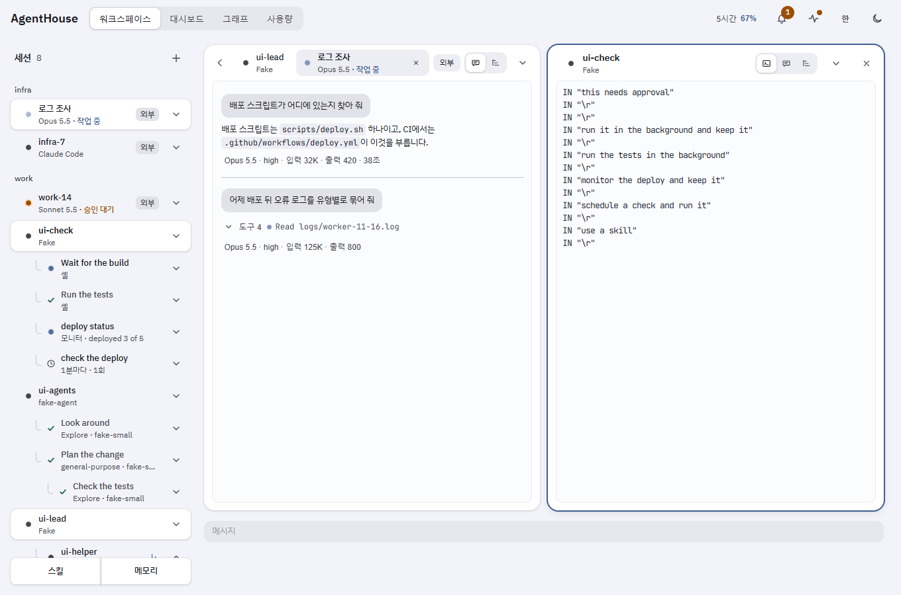
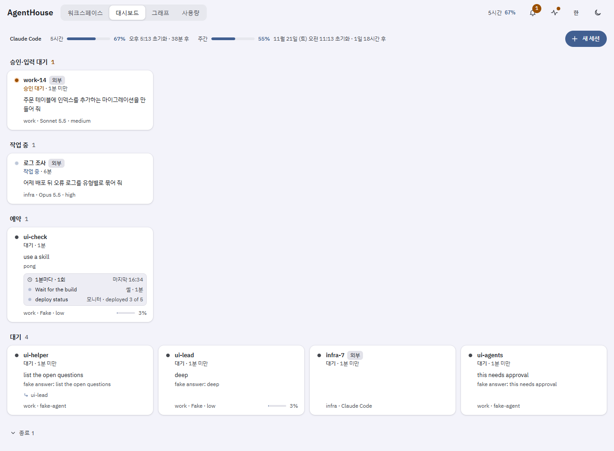
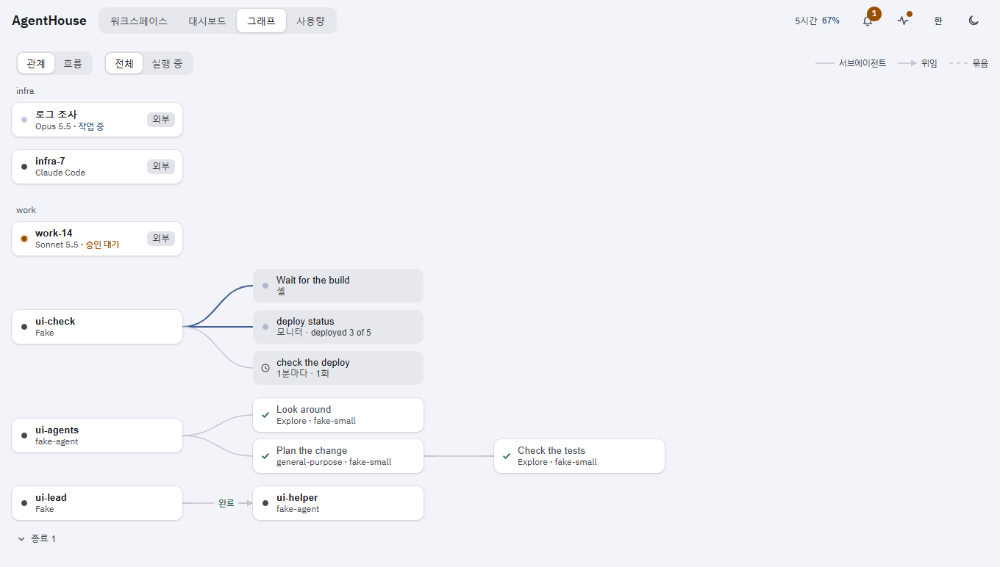
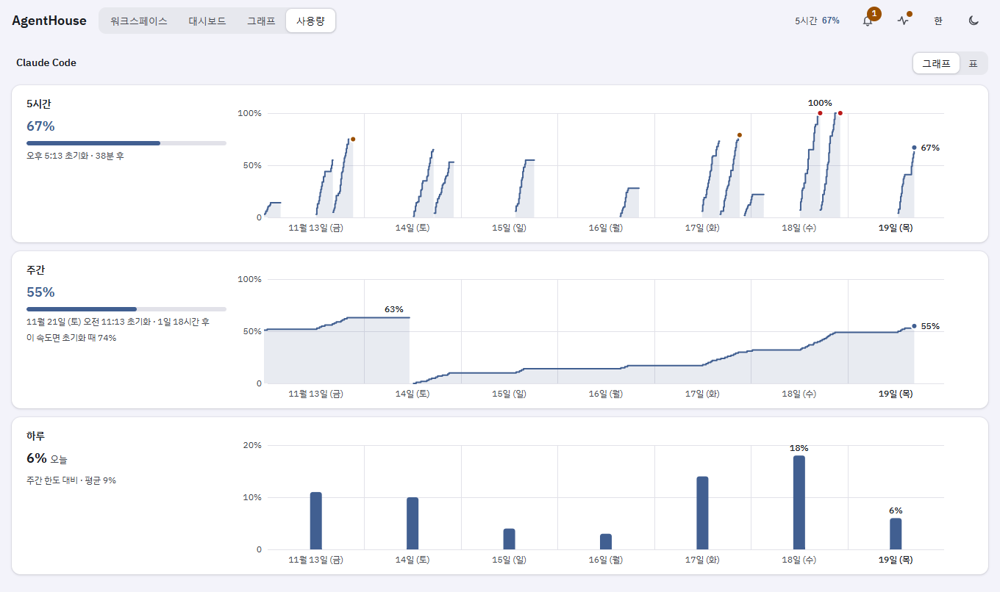

# AgentHouse

English · [한국어](README.ko.md)

A local web console that runs several Claude Code sessions side by side in real browser terminals and shows, at a glance, what each one is doing.



## Features

### Workspace

- **Real terminals in the browser**: your installed Claude Code, as it is, signed in with your own account. As in Windows Terminal, `Ctrl+C` copies a selection and `Ctrl+V` pastes.
- **Tabs and free splits**: a pane holds several sessions as tabs, and the room splits into up to six panes, side by side or one above the other. Drag a session to place it, and the gap between two panes to resize them.
- **Session tree**: each session shows whether it is working, waiting for an approval or idle, and under it what it started: sub-agents, background commands and scheduled prompts (`/loop`).
- **Conversation view**: instead of the terminal, the prompts, replies, tool calls and sub-agents, with model, effort and tokens per turn.
- **Flow view**: when a session and each of its sub-agents worked, as bars over time.
- **Message box**: Korean-safe typing, and one message to several sessions at once (drag them onto it, `Ctrl+Enter`). A session waiting for an approval or an answer is skipped, so a message never answers a dialog.
- **Grouping and delegation**: put a session under another one, or hand one session's reply to another as work and get the answer back.
- **Sessions that outlive the server**: they keep running while the server restarts, and an ended session resumes where its conversation stopped.

### Dashboard



Every session as a card, by what it is doing: waiting for you, working, on a schedule, idle, ended. A card says how long the session has been so, what it was last asked and answered, what runs in it now, and its folder, model, effort and context.

### Graph



Draws what runs under which session. Map is a tree of sessions, sub-agents, background commands and scheduled prompts tied by lines (an arrow for a delegation, a dashed line for a group). Flow lays out when every session worked, on one sheet.

### Usage



The Claude plan's 5-hour and weekly windows and what each day took, over the last seven days, as graphs or as a table, with where the week is heading at the pace so far.

### Also

- **Sessions started elsewhere**: a Claude Code session started in a terminal or an editor shows too, marked External, read-only.
- **Notifications**: the bell at the top counts the sessions waiting for you, and a browser notification comes while the tab is in the background. Finished work can be announced as well.
- **Skills and memory**: a folder's skills, CLAUDE.md and memory notes, listed and edited.
- **Environment check**: at the start it checks the CLI, its login and the hooks, and says what to do when something is wrong.
- **Korean and English, light and dark**

## How it works

- Runs only on your machine (`127.0.0.1`), behind a one-time login address, a Host allowlist and an Origin check.
- Uses the CLI exactly as installed: no reinstall, no PATH changes.
- Never reads credential files and never proxies model traffic.
- Observes a Claude Code session through hooks and a status line passed to that session alone with `--settings`. Your settings files are not changed.

## Run

Needs Node.js 20.19+ or 22.12+, pnpm, and Claude Code installed and logged in.

```sh
pnpm install
pnpm build
pnpm start   # prints a login address and opens it in the browser
pnpm stop    # ends every session and the session host
```

Built and checked on Windows 11. It is written to run on macOS and Linux as well, but has not been checked there yet. Codex CLI can be started in a terminal too, without a status view, and has not been tried with a real Codex install.

The screenshots show the made-up sessions of the UI check, with the page in Korean (English is a button in the top bar). The sessions named `ui-…` or `Fake` run a stand-in agent used for testing.

Working on the code: see [AGENTS.md](AGENTS.md).

## License

[MIT](LICENSE). AgentHouse is an independent project. It is not affiliated with or endorsed by Anthropic or OpenAI. "Claude Code" and "Codex" are used only to describe compatibility.
